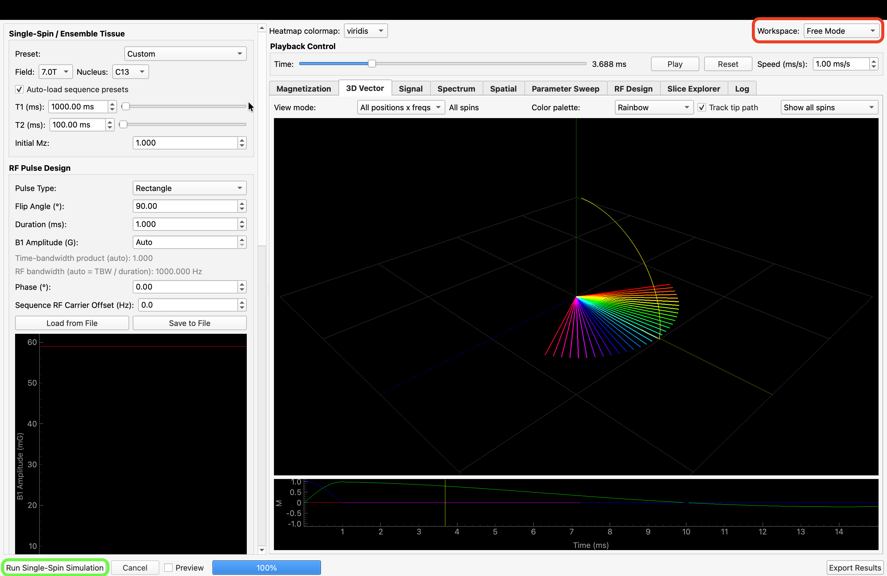
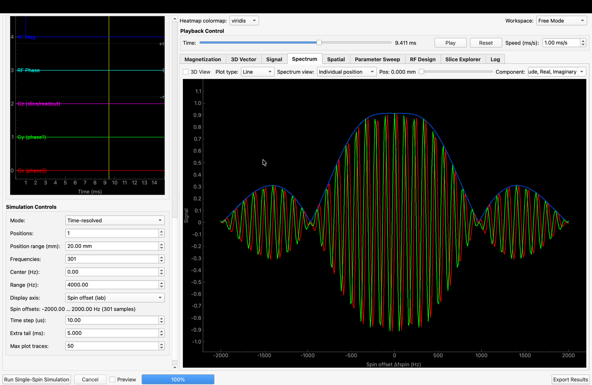
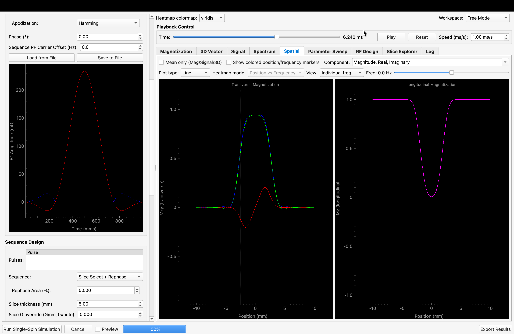
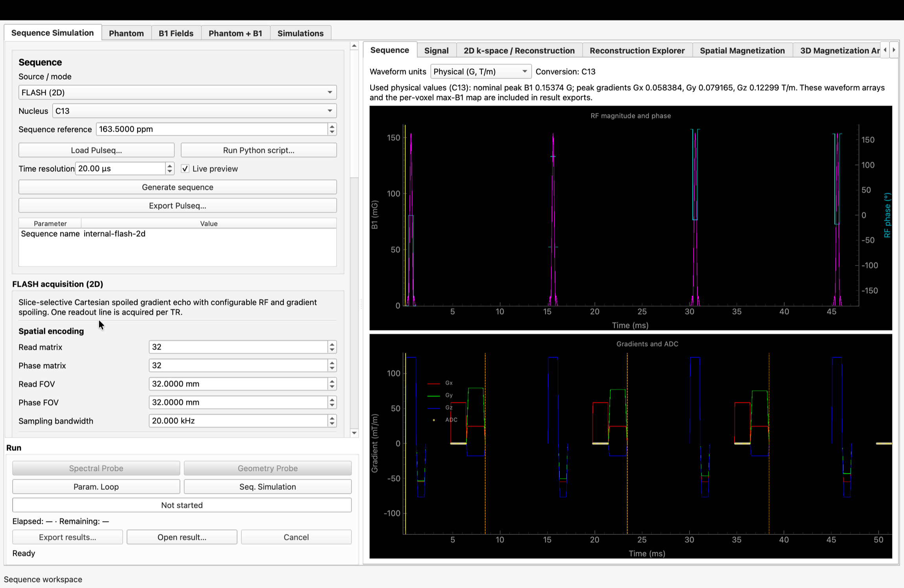
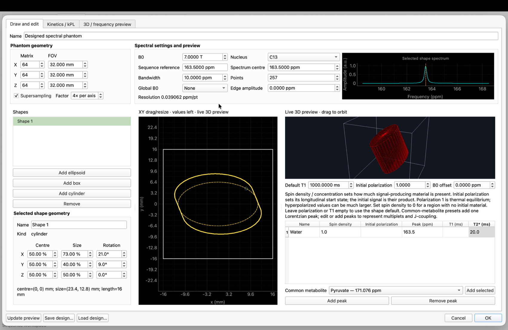
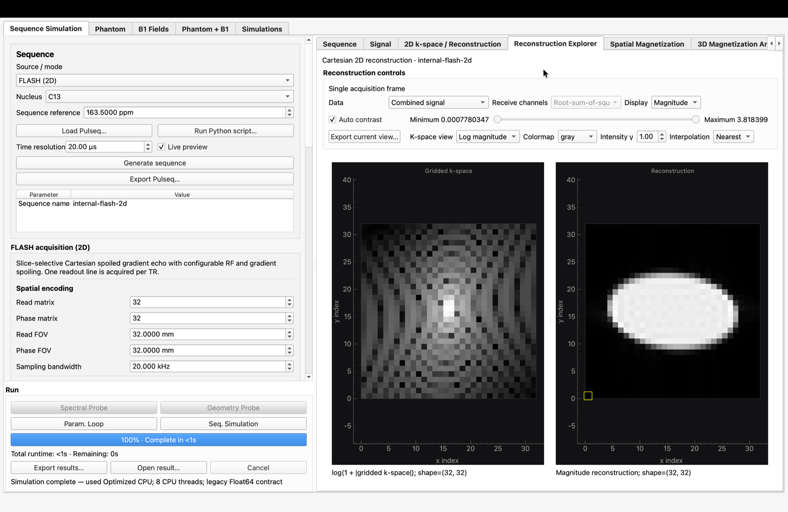

# Bloch Equation Simulator - User Guide

This guide covers the installation, usage, and features of the Bloch Equation Simulator. This tool allows you to simulate Magnetic Resonance Imaging (MRI) physics using the Bloch equations, with features for custom pulse design, sequence generation, and interactive visualization.

## 1. Installation

### Method A: Direct Install (PyPI)
*Recommended for most users.*
```bash
pip install blochsimulator
```

For other installation methods see [README](https://github.com/LucaNagel/bloch_sim_gui/blob/main/README.md).

## 2. Launching the Simulator

### From Terminal
Once installed, you can launch the GUI directly:
```bash
blochsimulator-gui
```

### From Jupyter Notebook
You can launch the GUI from within a notebook cell:
```python
!blochsimulator-gui
```

## 3. GUI Overview

#### Free Mode

***Free Mode***: This mode lets you perform highly resolved simulations of spins and obeserve their behaviour under RF pulse and gradients.
Highlighted in green is the <font color="green"> **Run Single-Spin Simulation** </font> button to start the simulation. The <font color="red"> **Workspace** </font> dropdown lets you switch between *Free Mode* (shown here) and *Sequence Mode*.

The interface is divided into two main areas:

*   **Left Panel (Controls):** Configuration for Tissues, RF Pulses, Sequences, and Simulation Settings.
*   **Right Panel (Visualization):** Interactive tabs for viewing results (Magnetization, 3D Vector, Signal, Spectrum, Spatial).

##### Simulation Results

***Spectrum***: The Spectrum Tab lets you see the time-resolveed behaviour of spins at different frequencies to your sequence, in this case a non-localized hard pulse, hence the ringing.



***Spatial***: The Spatial Tab lets you see the time-resolveed behaviour of spins at different position to a slice-selective sequence. In this case, a sinc pulse with Hamming apodization was chosen as the RF pulse.


#### Sequence Mode
By switching the  Workspace to sequence mode, we can now simulate pulseq sequences, that are either live generated, or can be loaded.


***Sequence Mode***: A preview of a 2D FLASH sequence. Nucleus was set to 13C, reference frequency to 163.5 ppm (13C-Urea). By ticking *live preview*, changing parameters automatically update the preivew of the sequence. This can be slow for big sequence (many repetitions especially).
Zooming into the preview works by scrolling either on the *Time (ms)* axis (changes zoom in x) or on the B1(mG) or Gradient (mT/m) axis to change the zoom in y.



***Sequence Mode Phantom design***: By either hitting **Seq. Simulation** with no loaded phantom, or by going to the *Phantom* Tab on the top, you can get to the phantom designer. This lets you design your phantom (shape, position, size), setting resonances, T1, T2, density.



***Sequence Mode Reconstruction Explorer***: You can inspect the simulation results in the Reconstruction Explorer after the simulation ran. This is the simulation of what you would see on your scanner if you ran the sequence with the set parameters, phantom and B1.


## 4. Key Use Cases & Tutorials

### Use Case 1: Basic Simulation & Animation Export
**Goal:** Simulate a Spin Echo and create a GIF of the magnetization vector.

1.  **Configure Tissue:** In the **Tissue Parameters** box (top left), select "Gray Matter" from the preset dropdown.
2.  **Select Sequence:** In **Sequence Design**, select "Spin Echo".
    *   *Note:* TE and TR will auto-load standard values (e.g., TE=20ms, TR=500ms).
3.  **Run:** Click **Run Simulation** at the bottom left.
4.  **Visualize:** Switch to the **3D Vector** tab on the right.
    *   Use the **Playback Control** slider (bottom) to scrub through time.
    *   Click **Play** to watch the dynamics.
5.  **Export Animation:**
    *   In the **3D Vector** tab, click the **Export ▼** button at the top right.
    *   Select **Animation (GIF/MP4)...**.
    *   Choose a filename and save.

### Use Case 2: Exporting Data & Jupyter Notebooks
**Goal:** Save simulation results and generate a notebook to reproduce them.

1.  **Run a Simulation** (as above).
2.  **Export:** Go to **File > Export Results** (top menu bar).
3.  **Configure Export Dialog:**
    *   **HDF5 (.h5)** and **Notebook: Analysis** are enabled by default, so the
        raw data and a `.ipynb` file that loads and plots them are exported
        together.
    *   Check **Notebook: Reproducible** to generate a `.ipynb` file that contains all parameters to re-run the simulation from scratch.
4.  **Finish:** Click **Export**. You can now open the generated `.ipynb` files in Jupyter Lab/Notebook.

Set the folder initially offered by project, result, Pulseq, image, animation,
data, and notebook dialogs under **Tools → Settings → General → Default export
directory**.

The Qt control style can be changed under **Tools → Settings → Interface →
Application style**. **Automatic** keeps native controls on macOS and uses the
cross-platform Fusion style elsewhere; **System / native** and **Fusion** can
also be selected explicitly. The change is applied immediately and saved for
future launches.

In the event-based **Sequence Simulation** workspace, **Export Pulseq…**
offers three choices: Pulseq plus a generating notebook, Pulseq only, or
notebook only. Pulseq plus notebook is the default. The notebook records the
exact EPI, spiral, EPSI/MGE, CSI, FLASH, Cartesian 3D bSSFP, spectrally
selective 3D bSSFP, Cartesian multi-echo 3D bSSFP, or radial multi-echo 3D
bSSFP builder function and all current GUI parameters, then writes the
corresponding `.seq` file when executed.

Sequence generation is explicit by default: finish editing the acquisition
parameters and click **Generate sequence** to refresh the timeline. Enable
**Live preview** beside the button only when the sequence should be regenerated
after every parameter change. Starting a simulation or spin probe also ensures
that a pending generated sequence is built first. If generation fails, the
last valid timeline remains visible and the parameter error is shown above the
controls.

**Sequence reference** is the absolute ppm frequency that the sequence treats
as 0 Hz. Every RF and receiver carrier offset is relative to that value. It is
a sequence parameter and is stored in generated Pulseq definitions. The
phantom's simulated spectral window remains independent: **Spectrum centre**,
**Bandwidth**, and the absolute peak positions determine which frequencies are
simulated. Phantom spectrum previews show the sequence reference as an orange
dashed line. Starting a sequence simulation displays a confirmation when that
line falls outside the configured spectral window. Choose **Continue** to run
anyway or **Cancel** to return without starting; Cancel is selected by default.
Starting a run also preserves the currently selected result tab; use the
**Signal** tab when the ADC signal, FID, or CSI spectrum is wanted.

Use **Param. Loop** to open the **Parameter Loop** tab and select a numerical
sequence parameter. Under **Values from**, choose **Manual values** to enter
a comma-separated list, for example `30, 60, 90, 45`. The loop runs one
simulation per value in the entered order, including repeated values. Use a
dot for decimals, such as `0.5, 1, 1.5`; scientific notation such as `1e-3`
is also accepted. The list can contain up to 500 finite numbers. The formula,
range, and point-count controls are disabled in this mode.

Choose **Formula** to enter a **Formula y =**, the start and end of the **x
range**, and the **Number of points**. The loop evaluates the formula at
evenly spaced $x$ values and runs one simulation per resulting parameter value:

$$
x_i = a + \frac{i}{N-1}(b-a), \qquad y_i = f(x_i),
\qquad i = 0, \ldots, N-1, \quad N > 1.
$$

For example, formula `sin(x)`, start 0, end 5, and 11 points produce
`sin(linspace(0, 5, 11))`. Use `x` for linear spacing, `x^2` or `x**2` for
squared values, or expressions such as `exp(-x)`. Trigonometric functions
use radians; `pi` and `e` are available. A single point uses the start value.
The **Values** preview shows the generated parameter values. A small plot beside
the editor shows these values against their index (starting at 0), including repeated
values and rounded integer parameters. Both previews update as you edit;
invalid input clears the plotted points. The loop accepts finite values
outside the sequence form's default editing range, including
negative RF scales and scales above 10. The corresponding form field expands
to accommodate each requested value. Integer parameters are rounded and must
fit the form field's 32-bit integer representation. Sequence generation and
simulation still validate requirements such as positive durations and matrix
sizes.

For large loops, set **Results** to **Save to folder (limit RAM)** and choose
an **Output folder** with **Browse…** or enter its path. Each completed run is
saved immediately as a separate `.blochproj`, including the simulation result,
sequence, phantom, and current setup. By default, filenames include the loop
iteration, parameter, and value, so repeated values produce separate files.

The loop waits for each file to finish saving before starting the next
simulation. Earlier results from this loop are released from memory; the
current result remains visible. Existing session simulations are preserved.
Reopen saved runs with **Open Project…** or browse the output folder in the
**Project Explorer**. **Keep in memory** retains the existing session workflow.
Cancelling during a save finishes the current file before stopping. A save
failure stops the loop and retains the unsaved result for manual export;
earlier files remain available.

In **Reconstruction Explorer**, the **Simulation** list includes each completed
loop iteration retained in memory with its parameter value. Choose a run to
inspect its images, k-space, or spectra without changing the sequence setup.
These results remain available during the current application session and also
appear under **Simulations**. Renaming or deleting a run there updates the
reconstruction list.

To export several retained runs, select them under **Simulations** and choose
**Export selected…**. Choose the output folder and **File naming**:

- **Current names** preserves the existing date/time names and manually renamed
  runs. Direct loop saves keep their existing iteration and parameter names.
- **Prefix + date and time** uses your prefix followed by the completion date
  and time, for example `study_20261015_120000.blochproj`.
- **Prefix + number** uses your prefix, **Start** number, and minimum number of
  **Digits**. Prefix `simulation`, start 1, and 2 digits produce
  `simulation_01.blochproj`, `simulation_02.blochproj`, and so on.

The preview shows up to three filenames. Existing files are preserved; numbered
exports skip occupied numbers, and date/time names receive a suffix when
needed. Batch numbering follows the selected rows from top to bottom. The
same naming controls are available in **Parameter Loop** when saving to a
folder, where numbering follows the simulation order. Single-run session
exports use a Save dialog where the filename can be edited directly.

In **Spin probe → Spectrum**, **Y scale** controls how magnetization is
reported. **Per-spin response (90° = 1)** divides by the configured initial
magnetization magnitude `M0`, so an ideal on-resonance 90° excitation produces
`|Mxy| = 1`. **Normalize displayed maximum to 1** rescales each displayed
non-phase curve or image independently, while **Raw magnetization** preserves
the unscaled simulated values. Phase curves are never amplitude-normalized.
Set **Y max** to a positive value to keep one fixed vertical scale across all
spin-probe time points; leave it at **Auto** for data-dependent axis limits.

Use **Run Python script…** to execute an existing sequence-generation script
with the same Python interpreter as the application. Standard output and
errors stay visible in a GUI log window. When the script creates or updates a
Pulseq `.seq` file in the script directory or Sequence workspace, the newest
output is imported automatically. **Stop script** first requests a normal
termination and force-stops an unresponsive process after a short grace period.

Generated sequences explicitly mark the end of every spoiler block. **Settings
→ Simulation → Spoiler simulation** selects one of two models:

- **Ideal crusher** preserves the fast historical behavior. At every declared
  spoiler end, `Mx` and `My` are set to zero for every pool while `Mz`,
  relaxation, inflow, and chemical exchange continue normally. It always uses
  one spin per voxel; the subvoxel controls and the Spoiling quality panel are
  disabled because no intravoxel gradient sampling is needed.
- **Gradient waveform** ignores the artificial transverse reset. Every voxel
  is represented by the configured X/Y/Z subvoxel spins, and spoiling follows
  from their positions and the actual gradient waveform. Subspins remain
  separate for the complete sequence, so later gradients may refocus them.

Ideal-crusher markers are used by all built-in generators that contain
spoilers, including EPI, spiral, EPSI/MGE, CSI, MPRAGE, UTE, and 3D bSSFP.
Imported Pulseq files receive ideal treatment only when they contain an explicit
`IdealSpoilerEndTimes` marker (or one of the legacy generated-sequence spoiler
definitions); arbitrary gradients are never classified heuristically. In
gradient-waveform mode all gradients act physically whether or not a spoiler
marker is present.

In gradient-waveform mode, subvoxel counts are axis-specific because their
product controls runtime.
**Regular midpoint grid** is the efficient symmetric quadrature rule. The
optional **Deterministic stratified points** place one reproducible point in
each stratum and avoid short exact grid recurrences, but generally need more
spins for the same quadrature error. Through-slice subvoxel sampling requires a
3D phantom with explicit Z extent; a single Z voxel is sufficient.
The relevant spoiler strength is the phase spread **inside one phantom
voxel**, not merely the number of cycles across the complete imaging FOV. A
regular midpoint grid can appear perfectly spoiled after one crusher and then
rephase exactly after several repetitions. The FLASH panel therefore evaluates
every accumulated crusher order in the RF train, reports the first artificial
rephasing and maximum error relative to a continuous voxel, and offers the
smallest tested train-safe midpoint grid. The recommendation also enforces the
spatial sampling required when a phantom voxel is coarser than an imaging
voxel and at least two points along every axis with a crusher moment; a centered
singleton cannot represent gradient phase or slice-selective RF evolution on
that axis. For example, a `3 × 3 × 3` grid at one cycle/voxel has zero coherence
after one crusher but returns to 100% at crusher order 3. For a 64-line FLASH
train, mutually non-recurrent axis counts totaling roughly 65 spins can be much
safer than an isotropic grid with a larger apparent single-crusher accuracy.

Every 3D sequence panel has independent signed **Read gradient direction** and
**Phase gradient direction** controls in its spatial-encoding section. The
right-handed **Partition gradient direction** is derived as Read × Phase and
shown immediately. For example, Read `+z` and Phase `+y` produce Partition
`-x`. FOV and matrix values remain ordered as `(read, phase, partition)`, while
the generated Pulseq gradients, phantom coverage check, reconstruction, and
export use the selected scanner axes consistently. Each sequence stores its
orientation in the Pulseq definitions, so reloading a generated `.seq` file
preserves it.

**SS-bSSFP (3D)** alternates complete Cartesian volumes between the configured
metabolite targets. Enter matching comma-separated target names, RF offsets,
receiver offsets, and flip angles. A flip angle of exactly 0° disables that
target's RF pulse while preserving the acquisition timing. **Use selected
phantom peak frequencies** matches both RF and receiver offsets to named peaks
such as Lac/Lactate and Py/Pyruvate, preventing an accidental carrier/phantom
frequency mismatch. The defaults follow Skinner et al.
(doi:10.1002/mrm.29676), including the narrow-band SLR pulse, alpha/2
preparation, and end-of-volume spoiler. The recommended voxel-referenced
spoiler defaults to one cycle across each actual simulation-phantom voxel; the
legacy cycles/FOV value remains available as an optional additional moment.
The panel reports the effective XYZ cycles/voxel and predicted retained
coherence for the selected subvoxel grid. RF bandwidth is calculated from pulse
duration and pulse shape instead of being entered independently. For Sinc
pulses, the selectable lobe count sets
the time-bandwidth product. Field strength and nucleus use the shared
Simulation object reference, including in Spin probe mode. With the default
scanner limits, the
encoding-lobe duration is calculated automatically from FOV, matrix, sampling
bandwidth, and gradient limits. The published 32-point, 10 kHz readout lasts
3.2 ms; that ADC duration is kept separate from the shorter pre-/rephasing
lobes. The published 6.29 ms TR requires a scanner profile capable of producing
the automatically calculated encoding moments within the remaining TR time.

Run `examples/validate_ss_bssfp_spoiling.py <project.blochproj>` for a quick
saved-project check. Add `--flash-example` to reproduce the 4 cycles/3 mm/
0.5 mm FLASH calculation, or `--run-species` for the slower metabolite-resolved
physical-gradient versus Ideal Crusher comparison. The interactive equivalent
is `tutorials/ss_bssfp_spoiling_validation.ipynb`.

**ME-bSSFP (3D, Cartesian)** acquires an odd number of echo volumes inside each
balanced TR. Choose **Flyback** for monopolar readouts with phase-rewinding
gradients or **Symmetric bipolar** for alternating readout polarity. The
publication controls follow Gaubatz (2023): five echoes centered between RF
pulses, 180° RF phase increments, Gaussian excitation, and α/2 preparation.
The short in-vivo preset uses TR 8.696 ms, echo spacing 1.32 ms, 39.6825 kHz
requested sampling bandwidth, FOV 56 × 28 × 24.5 mm³, and matrix 32 × 16 × 14.
The GUI begins with a smaller matrix for responsive setup. Individual echo
volumes are reconstructed and selectable. If echo times and simulated pool
frequency offsets are available, the Reconstruction Explorer also offers a
linear known-frequency IDEAL estimate. This initial estimator does not fit a B0
field map and is labelled accordingly; use a field-map-aware iterative method
for quantitative scanner reconstruction.

**Radial ME-bSSFP (3D)** creates monopolar center-through echoes on a spherical
spiral-phyllotaxis trajectory. Its publication preset follows Wang et al.
(doi:10.1002/mrm.30614): TR 16 ms, five echoes at 2 ms spacing, 1000 Hz/px,
and golden-angle rotation between dynamic measurements. The GUI starts with a
small interactive spoke count; set 300 spokes and four measurements to match
the in-vivo acquisition. Its trajectory read, phase, and derived partition
axes orient the complete phyllotaxis coordinate system; they do not imply a
fixed phase-encoding gradient, because every radial spoke has its own readout
direction. Simulated ADC data are density-compensated and
trilinearly gridded onto an isotropic 3D reference matrix, then shown as linked
orthogonal slices in the Reconstruction Explorer. This dependency-free gridding
is intended for interactive validation; a scanner reconstruction should still
use a validated NUFFT and trajectory/density-correction pipeline. Multi-echo
results retain separate echo and measurement dimensions and can use the same
linear IDEAL estimate described above.

For EPI, **Readout trajectory** selects a conventional bipolar Cartesian echo
train, a monopolar **Flyback** echo train, or a single-interleaf centre-out
spiral. Flyback acquires every k-space line in the same read direction and
combines the kx rewinder with the phase-encoding blip between lines. This costs
more readout time but avoids alternating readout polarity. EPI, spiral,
EPSI/MGE, CSI, and FLASH provide axial, coronal, and sagittal plane presets plus
explicit signed
**Read gradient direction** and **Phase gradient direction** controls. The
slice-selection gradient is displayed separately and derived as Read × Phase,
so swapping read and phase within the same plane is unambiguous. Custom axis
combinations and the signed slice or slice-package offset are applied to the
physical Pulseq gradient axes and stored in the encoding definitions. **Slice
gap** is the empty edge-to-edge distance between adjacent slices; the centre
spacing is slice thickness plus gap. EPI/spiral expose an explicit echo time;
for EPI it targets the centre of k-space and for centre-out spiral it targets
the first ADC sample. Spiral readout duration is extended automatically if the
requested sampling bandwidth would exceed the configured gradient or slew
limits.

**EPSI / MGE (2D)** acquires one complete multi-gradient-echo train for every
phase-encoding line. **Bipolar** alternates the read direction between echoes;
**Flyback** keeps all echoes in the same direction. The labelled ADC stream is
reconstructed directly as selectable Cartesian MGE echo frames. Because the
echoes are uniformly spaced, the same echo dimension can also be treated as
EPSI spectral time: the spectral bandwidth is $1 / \Delta \mathrm{TE}$ and the
nominal spectral resolution is
$1 / (N_{\mathrm{echo}} \Delta \mathrm{TE})$. The panel reports
both values and exposes TE1, echo spacing, echo count, per-line TR, slice
geometry, RF spoiling, and end-of-train gradient spoiling.

**FLASH (2D)** generates a slice-selective Cartesian spoiled gradient-echo
acquisition. Matrix, FOV, RF pulse shape, slice package, TE, TR, RF-spoiling
increment, and through-slice/in-plane gradient spoiling are configurable. The
Sequence parameter forms are separated into spatial encoding, RF, slice
selection, timing, spoiling, and derived-sampling sections.

**Auto spoiler** is enabled by default. It updates the through-slice and shared
in-plane spoiler strengths whenever the phantom voxel size, FLASH geometry,
orientation, or subvoxel sampling changes. The selected moments reach the first
continuous-voxel coherence null; for the shared in-plane control an axis with
more than one subvoxel spin is preferred so the simulated midpoint grid also
reaches that null. Auto spoiler controls the physical gradient moment; it does
not by itself guarantee that a finite regular spin grid remains dephased across
the complete train. Check the train-wide warning and use **Apply train-safe
subvoxel grid** when needed. Disable the checkbox to enter both strengths
manually.

For repeated complete acquisitions, **Acquisition interval
(start-to-start)** controls the time from the beginning of one complete image,
volume, or radial measurement to the beginning of the next. It is separate
from the TR between individual excitations or k-space lines. **Back-to-back**
uses the shortest possible interval; a numerical value inserts an idle delay
after each complete acquisition. The requested interval must be at least as
long as one complete acquisition. This control applies to CSI, FLASH, all 3D
bSSFP variants, and radial measurements. EPI and spiral already use their
acquisition-interval field with the same start-to-start definition. Generated
Pulseq files store the requested and actual interval together with all
acquisition start times.

All MRI geometry fields in the Sequence workspace, Phantom tools, and K-space
trajectory controls use **millimeters (mm)** consistently. This includes FOV,
slice thickness, slice gap, and spatial probe positions. Values are converted
to SI meters internally for simulation and Pulseq export.

Every generated sequence now uses the same RF field set and global envelope
designer. Choose **Sinc**, **SLR**, **Gaussian**, **Block**, **RF Pulse
Designer**, or **Spectral-spatial Designer**, then set duration,
time-bandwidth product, Sinc lobe count, apodization, SLR sharpness, and RF
carrier offset as applicable. Shape-specific controls are only shown for the
selected pulse type. SLR sharpness is a positive integer: order 1 is one
central lobe, while higher orders narrow the designed transition and visibly
add temporal side lobes. Sinc apodization remains non-negative from 0 to 1;
0.5 is Hann and 1.0 is Hann squared.
Free Mode and Sequence Mode now call the same analytic envelope factory for
Sinc, SLR, Gaussian, and Block pulses. Sinc samples are centred on the RF
raster, producing a symmetric waveform with complete matching edge lobes;
mode-specific apodization choices are applied after that common base shape.
Standalone scripts call the same public design path as well.

**RF Pulse Designer** uses the current complex baseband waveform from the
**RF Design** tab. **Load RF pulse…** is also available inside every Sequence
Mode RF section for `.exc`, `.dat`, `.txt`, and `.csv` waveforms. Duration,
complex phase modulation, and carrier offset are preserved, while amplitude is
rescaled from the loaded pulse's reference flip angle to the sequence flip
angle. Loaded pulses work for EPI, spiral, EPSI/MGE, CSI, FLASH, Cartesian and
radial bSSFP, SS-bSSFP, and Cartesian multi-echo bSSFP.

**Spectral-spatial Designer** creates a coupled RF and balanced flyback
slice/slab-gradient waveform. Its primary inputs describe the desired
excitation directly: a spatial center, width, and transition width plus one or
more spectral pass bands entered by lower and upper frequency edge. Each
spectral band also has an explicit transition width, relative flip angle, and
phase. Frequencies are offsets from the RF carrier and the designed response
repeats at the reported alias spacing.
The designer shows the absolute sequence reference in ppm and the current RF
carrier offset. Metabolite profiles use the selected spectral phantom when one
is available. Every peak is displayed as absolute ppm, offset from the
sequence reference, offset from the RF carrier, and folded position in the
SPSP alias period. The UI explicitly says when it is using presets instead.

The **Simulation and validation range** can either follow the spatial target
and one alias period automatically or use independently entered position and
frequency limits and sample counts. **Excitation map** runs a relaxation-free
Bloch simulation on that complete two-dimensional grid. Its color scale shows
flip angle in degrees, dashed lines show the requested target edges, and the
two plots below it show a spatial profile at the selected frequency and a
spectrum at the selected position. The reported sampled-grid metrics include
pass-band RMS and maximum error, maximum stop-band flip angle, duration, peak
RF field, and peak gradient.

Metabolite presets are optional conveniences rather than separate simulation
objects. A preset can replace the target table with bands around
nucleus-specific metabolite frequencies. **Plot metabolite spatial profiles**
uses actual current-phantom peaks when possible and otherwise uses clearly
identified presets. The full continuous-frequency response remains visible in
**Excitation map**. Missing schedule targets, reference mismatches, and unmet
sampled filter specifications produce visible warnings.

**Manage pulse library and schedule…** separates reusable pulse designs from
their ordered use. The upper table creates, duplicates, edits, and deletes
pulses. The lower table chooses a pulse, display and target-metabolite names,
an enabled state, flip-angle or relative-amplitude scaling, and an immediate
repeat count for each row. Entries can be duplicated, deleted, and moved up or
down. The enabled rows, including their repeat counts, form a cyclic schedule.

For **Flip angle**, the entered value is the requested strongest-pass-band
flip angle. For **RF amplitude scale**, the stored complex RF waveform is
multiplied directly, so

$$
\alpha = s_{\mathrm{RF}}\alpha_{\mathrm{ref}}.
$$

The gradient waveform is not multiplied by this RF scale. Every entry is
revalidated for nucleus, B1, gradient, slew, duration, and target thickness.

**Preview pulse schedule** provides previous/next navigation, automatic
playback, per-step waveforms and excitation maps, actual phantom-metabolite
profiles, a schedule-step by metabolite $|M_{xy}|$ table, and cumulative
$M_z$/$|M_{xy}|$ plots. Common fixed scales are enabled by default so small
residual excitation is shown quantitatively rather than enlarged by automatic
contrast. The preview uses complete complex RF and gradient waveforms on a
reduced spatial grid and includes coherent state propagation, inter-pulse
off-resonance, optional T1/T2* relaxation, and ideal/no spoiling. It omits
readout encoding, B0 distributions, motion, exchange, and reconstruction.

FLASH advances the schedule once per complete image frame by default. All
phase-encoding lines and slices of that frame use one schedule step. Set the
FLASH repetition count to the desired number of frames; selection cycles
deterministically through the enabled expanded schedule. The explicit
**Every TR/RF event** mode mixes contrasts across k-space and is intended only
for advanced experiments. Pulseq export records its schedule index in the
`SET` ADC label. Different pulse durations receive individual TE/TR delays;
an impossible timing combination is rejected with the affected entry name.

Advanced controls contain spatial time-bandwidth product, subpulse duration
and count, linear- or minimum-phase spectral FIR selection, spatial and
spectral pass-/stop-band ripple, and scanner gradient, slew, B1, and pulse
duration limits. The flyback rewinder is designed independently from the
positive excitation lobe, and the designer searches raster-compatible alias
periods before constructing the spectral FIR. Accepting the design makes it
available to every generated sequence. Two-dimensional sequences override the
reference center with each actual slice position; three-dimensional sequences
apply it along the partition/slab axis. The complete RF waveform, gradient
waveform, spatial reference, spectral bands and transition widths, nucleus,
and reference thickness are saved in project files. A design must be recreated
after changing the nucleus because its gradient frequency units are
nucleus-specific.

The visible **Method and attribution** section identifies the Larson/Kerr
design basis and opens the LarsonLab reference toolbox. This native Python
implementation does not claim numerical equivalence to the MATLAB toolbox or
endorsement by LarsonLab, Stanford, or UCSF. See
[Spectral-spatial RF pulse design](SPECTRAL_SPATIAL_RF.md) for the comparison,
unsupported modes, validation scope, and citation recommendation.

Total imaging readout bandwidth fields share one definition and control:
ADC dwell is `1 / bandwidth`, rounded to the scanner ADC raster. CSI spectral
bandwidth and radial pixel bandwidth remain separate because they describe
different physical quantities.

Scanner hardware limits are configured under **Tools → Settings → Scanner**.
Maximum gradient, maximum slew rate, waveform rasters, RF ringdown/dead time,
and ADC dead time are stored persistently and applied to all newly generated
EPI, spiral, EPSI/MGE, CSI, FLASH, and 3D bSSFP Pulseq sequences. Imported
`.seq` files retain their own event timing.

### Sequence-simulation kernels

The **Tools → Settings → Simulation** page exposes two independent kernel
selectors. A kernel is the numerical execution engine; changing it does not
change the phantom, pulse sequence, physical model, ADC times, or requested
checkpoints.

| Simulated object | Setting used |
| --- | --- |
| `Phantom`, sequence probes, and each independent component of a `SpectralPhantom` | **Sequence Bloch kernel** |
| Coupled `DynamicSpectralPhantom`, including additional product pools | **Dynamic spectral kernel** |

Both routes first compile the Pulseq events into propagation intervals. Event,
ADC, kinetic-breakpoint, and checkpoint boundaries remain exact. The configured
**RF-active simulation time step** is only a maximum interval length while RF is
active; making it coarser reduces work but also changes RF integration accuracy.
It is therefore a separate accuracy/performance choice, not another kernel.

### Post-run 3D magnetization animation

Enable **Create post-run animation** in the **3D Magnetization Animation** tab
to keep a bounded set of spatial magnetization states for the next run. The
**Time resolution** setting specifies the desired interval between frames in
milliseconds. The scientific simulation first runs normally, with only the
manually requested checkpoints. A separate replay then captures the animation:
targets in RF-free sequence intervals are retained at the chosen spacing, while
targets inside an RF pulse are snapped to an existing RF-integration boundary.
Consequently, animation capture cannot change the scientific signal, final
magnetization, checkpoints, or RF integration accuracy. The additional replay
does increase total run time when animation capture is enabled.

The animation is available only after the run has completed. Its map selector
shows `Mz`, coherent `|Mxy|`, `Mx = real(Mxy)`, `My = imag(Mxy)`, or transverse
phase; spectral and dynamic objects additionally expose their individual
pools. Frames are held separately from the scientific result and are not added
to result exports or to manually requested checkpoints. Choose `float32` for
the default display storage or `float16` for smaller animations. Very long
sequences or large objects automatically receive a coarser effective time
resolution to bound the temporary float64 checkpoint memory used during the
replay.

#### Sequence Bloch kernel

This kernel is used for the ordinary Bloch equation without coupled
pyruvate-to-lactate kinetics. A `SpectralPhantom` is represented by independent
spectral components; each component is simulated with this kernel and the
received signals are then summed.

| Selection | Implementation and intended use |
| --- | --- |
| **Optimized (recommended)** | Native streaming C kernel. It propagates one spin through the complete sequence without storing a spin-by-time history, processes active spins in bounded chunks, and distributes spins over the configured CPU threads. RF-free intervals avoid the general 3×3 rotation, RF-active intervals use a quaternion rotation, and phantoms with at most 64 distinct exact T1/T2 pairs reuse precomputed relaxation factors. Continuous T1/T2 maps automatically use per-spin factors instead. Use this for normal simulations. |
| **Strict reference (validation)** | Separately compiled Float64 reference extension selected in the GUI or with `sequence_kernel="strict_reference"`. It uses the general rotation-matrix path with per-spin/per-interval relaxation and has the same event, ADC, checkpoint, receive-coil, transmit-field, subvoxel, and spoiler semantics as the optimized kernel, but deliberately omits its fast paths. It disables fast math and floating-point contraction and reports the `strict-float64` numerical contract. Use it as the reproducible validation baseline or when diagnosing a suspected optimized-kernel problem, not as a performance choice. |

The optimized and strict reference paths implement the same Bloch
propagation, but their floating-point operation order is not identical. Very small rounding-level
differences are therefore possible. OpenMP parallelism is across spins, and
thread-local ADC sums are combined after propagation. This makes the standard
kernel much easier to parallelize than the dynamic solver.

#### Dynamic spectral model

The dynamic kernel keeps a separate magnetization vector for every spectral
pool in each simulated spin. The common two-pool model contains pyruvate and
lactate; supported additional product pools use the same timeline and receive
their established precursor-to-product conversion. During each compiled
interval the solver applies a symmetric free-evolution/RF/free-evolution split:

1. half an interval of T2 decay, gradient/static/dynamic-B0 phase, T1
   relaxation, longitudinal pyruvate-to-lactate conversion, and optional
   pyruvate inflow;
2. the RF rotation for both pools;
3. the second free half-interval, followed by any ADC observation, ideal
   crusher, or checkpoint at that state boundary.

For a segment with constant `kPL` and relaxation rates, the longitudinal
two-pool system is advanced with its analytic exponential solution. Piecewise
linear inflow is integrated analytically within each segment, including the
equal-rate limit. When concentration tracking is enabled, concentration is
advanced separately from polarization so that `Mz = concentration ×
polarization` and T1 relaxation approaches the configured equilibrium
polarization. Dynamic B0 changes transverse phase; it does not alter the
longitudinal conversion equations.

Unlike the ordinary streaming kernel, the dynamic solver retains the complete
pool state of the active object because its state must persist across the
continuous kinetic timeline. Runtime is therefore driven mainly by
`active spins × compiled intervals`, plus ADC reduction and any requested
checkpoints. The phantom's **spectral points** value defines the spectral output
grid; by itself it does not create that many Bloch states. Solver work instead
increases with the number of ADC samples in the sequence, which is a separate
quantity.

#### Dynamic spectral kernels

The GUI offers **Native automatic** as the default and, below a separator,
**Optimized NumPy** for compatibility checks and validation. The benchmark and
validation kernels `native_serial` and `reference` are no longer listed in the
GUI; they remain available from Python through `dynamic_sequence_kernel=...`. Hovering over a choice shows an
English summary of its purpose, current runtime availability, and fallback
behavior. The same capability registry is available from Python through
`detect_kernel_capabilities()` and is used by the kernel benchmark.

A stored GUI selection that is no longer offered resolves to the GUI default.
Settings saved by earlier versions recorded Optimized NumPy as the previous
default even when it was never chosen explicitly; these settings move to
Native automatic once. An Optimized NumPy selection saved afterwards is kept.

| Selection | Implementation and intended use |
| --- | --- |
| **Optimized NumPy (compatibility and validation)** | Complete production-capability CPU path. It keeps the transverse state in a persistent complex array, reuses scratch buffers, caches exact longitudinal coefficients by half-step duration, and caches T2/phase factors by duration, gradient, and dynamic-B0 integral. It supports inflow, delayed conversion, concentration tracking, dynamic B0, spatial transmit sensitivity, multiple receive coils, checkpoints, and both spoiler modes. It is also the safe fallback for unsupported native combinations. |
| **Native automatic (recommended)** | Adds OpenMP across spins to strict native primitives and bounded plan blocks. Parallel work starts at 1,024 simulated spins; smaller jobs automatically use one thread. The complete bounded driver supports unity, constant complex, or spatial transmit sensitivity, static or dynamic B0, delayed conversion, ADC, crushers, receive coils, subvoxel sampling, and checkpoints. It covers direct or polarized pyruvate inflow, with or without concentration tracking, as well as concentration tracking without inflow. A separate multi-pool worker supports the existing precursor-to-product conversions, including pyruvate-to-alanine. Voxelwise arrival delays use bounded local source tables. This is the GUI default for dynamic phantoms. |
| `native_serial` (Python only) | Uses the same compiled uniform-transmit RF and longitudinal primitives with one worker thread. The common Phantom Designer model with pyruvate inflow, a polarization curve, and concentration tracking advances both states in one fused pass. This option is useful for separating gains from compiled blocks from gains due to multithreading; it is not normally needed for production simulations. |
| `reference` (Python only) | Direct, allocation-heavy Python/NumPy formulation. It recomputes intermediate phase, relaxation, exchange, inflow, and RF arrays at each interval and is the correctness oracle for the optimized CPU paths. It supports the complete model but is intended for small validation and diagnostic runs. |
The native extension receives coefficients already evaluated and rounded by
NumPy and is built without fast math or floating-point contraction. Individual
native primitives reproduce the optimized operation order bit for bit. The
persistent RF waveform block retains the same float64 integration topology but
may change the final few bits through its compiled complex-arithmetic path; its
result metadata reports a `float64-close` contract and it is regression-tested
with tight tolerances.

Native selection is capability-based rather than all-or-nothing:

| Active feature combination | Native RF | Native longitudinal evolution | Actual behavior |
| --- | --- | --- | --- |
| Two pools; no inflow or concentration tracking; unity, constant, or spatial transmit | Yes | Yes | Complete bounded native plan, including delayed conversion and static or dynamic B0 |
| Coupled inflow, polarization curve, and concentration tracking, with or without spatial arrival delays | Yes | Yes | Complete bounded native plan; delayed sources are prepared only for the current time/voxel block |
| Direct or polarized inflow without concentration delivery; concentration tracking with or without inflow | Yes | Yes | Complete bounded native plan with an explicit source mode matching the established model |
| Additional product pools and passive precursor-to-product conversion | Yes | Yes | Separate complete multi-pool plan worker; the specialized two-pool loop remains unchanged |
| Spatial transmit field with otherwise supported kinetics | Yes | Yes | Spatial native RF coefficient planes plus the applicable native longitudinal path |
| Unsupported precision or insufficient memory | Capability-dependent | Capability-dependent | Explicit hybrid or complete fallback to **Optimized NumPy** |
| Strict native extension unavailable | No | No | Complete fallback to **Optimized NumPy** |

Dynamic B0 is supported in all rows and does not by itself cause a native
fallback. It is part of the complete native plan both without inflow and with
all existing two-pool source modes, including spatial arrival delays. To retain the established
bitwise result for sequences that sample the unadvanced initial state, an ADC
event exactly at time zero also stays on that interval path. Later ADC events
remain part of the complete native plan. The completion status reports the
requested and actually used path, effective CPU thread count, numerical
contract, complete-plan model, and any fallback reason. Experimental CPU/GPU
results remain explicitly labelled. The same machine-readable fields are
retained in result metadata and exports, together with enabled native
RF/longitudinal blocks and the memory-limit decision.

Large expanded objects are divided only at parent-voxel boundaries. All
subvoxel spins belonging to one parent remain together for the entire sequence,
and signal leaves are reduced in one fixed global parent order. Automatic
chunking starts above the local 131,072-spin limit or when the memory plan
requires it. Python callers can request a smaller deterministic block with
`parent_voxel_chunk_size`; this changes memory use, not the result ordering.

For routine use:

- Keep **Sequence Bloch kernel → Optimized** for ordinary and independent
  spectral phantoms.
- Keep **Dynamic spectral kernel → Native automatic**. Unsupported parts fall
  back explicitly to Optimized NumPy, and the persistent block reports its
  close-float64 contract. Select **Optimized NumPy** when bit-identical
  agreement with earlier Optimized NumPy results is required.
- Use the Python-only `reference` kernels only for a controlled comparison.
  They are expected to be slower, and low CPU utilization is not evidence that
  they are more accurate for routine work.
- More CPU threads do not guarantee a proportional speed-up. Sequence driving,
  coefficient preparation, ADC summation, and unsupported longitudinal kinetics
  can remain in NumPy, while frequent small native calls incur OpenMP overhead.
- Dynamic state is always integrated in `float64`.

**Export results…** in the same workspace defaults to exporting both
`sequence_result.nc` and `sequence_result.ipynb`. The notebook loads the
adjacent NetCDF dataset and provides the signal, k-space, reconstruction, and
interactive multidimensional analysis views. Data-only formats and Bruker raw
export remain selectable alternatives. During a run, the line below the
progress bar shows elapsed and estimated remaining wall time. After completion
it keeps the total runtime visible. The xarray/NetCDF result stores this value
as `simulation_wall_time_s`, together with UTC start and finish timestamps in
the dataset attributes and full metadata JSON.

The **Reconstruction Explorer** tab is populated after a simulation. Its
controls select each available outer dimension independently (for example echo,
repetition, slice, or segment), the total or a simulated pool-resolved signal,
receive-coil combination, and magnitude/phase/real/imaginary display. Ordered
dimensions such as echo, repetition, slice, segment, frame, and the CSI spectral
sample use labelled sliders and appear only when present in the result. 3D image
and gridded-k-space volumes occupy separate full-size tabs, and each tab keeps
its own scanner-coordinate slice positions. In CSI, clicking a reconstructed
voxel updates its spectrum. **Open result…** loads an existing sequence-result
`.nc` file into this explorer without repeating the simulation; **Export current
view…** writes the selected scalar view. The adjacent image-display controls
select a colormap, gamma intensity, and nearest, linear, or cubic image-space
interpolation. They affect the reconstruction preview and PNG export without
changing the underlying reconstructed array; NumPy exports therefore remain
quantitative. With **Auto contrast** disabled, a two-handle range slider sets
the displayed minimum and maximum; the exact endpoint values are shown beside
the slider. With **Auto contrast** enabled, these endpoints follow the minimum
and maximum of the currently displayed image. Complete project files retain
these display settings, the explorer selection, and both independent 3D cursor
positions.

### Use Case 3: Parameter Sweep
**Goal:** Analyze how simulation metrics change when varying a parameter (e.g., Flip Angle, TE, TR, $T_1$, $T_2$).

1.  **Open Sweep Tab:** Click the **Parameter Sweep** tab on the right panel.
2.  **Configure Sweep:**
    *   **Parameter:** Choose from the dropdown (e.g., "Flip Angle", "TE (ms)", "$T_1$ (ms)", "Frequency Offset").
    *   **Range:** Set the **Start**, **End**, and number of **Steps**.
3.  **Select Metrics:** Check the outputs you want to track (e.g., "Signal Magnitude", "Final $M_z$").
4.  **Run:** Click **Run Sweep**. The simulator will iterate through the range and plot the results.
5.  **Export:** Click **Export Results** to save the sweep data to a CSV or NumPy file for further analysis.

### Use Case 4: Simulating Spatial Profiles (Slice Selection)
**Goal:** Visualize the slice profile of a selective excitation.

1.  **Design Pulse:** In **RF Pulse Design**, select "Sinc" (or "Gaussian").
2.  **Sequence:** In **Sequence Design**, select "Slice Select + Rephase".
3.  **Simulation Grid:**
    *   Set **Positions** to 100 (or more for higher res).
    *   Set **Range (mm)** to cover your slice (e.g., 20 mm).
4.  **Run Simulation.**
5.  **Visualize:**
    *   Go to the **Spatial** tab.
    *   You will see the **$M_{xy}$ (Transverse)** profile showing the excited slice.
    *   Switch **Plot type** to "Heatmap" to see the evolution of the slice profile over time (requires *Time-resolved* mode).

### Use Case 5: Custom RF Pulses
**Goal:** Import a custom waveform defined in a file.

1.  **RF Pulse Design:** Click **Load from File**.
2.  **Format:** Supports `.exc` (Bruker-style), `.dat`, `.txt`, `.csv`.
    *   For text files, a dialog will ask for the data layout (Amplitude/Phase columns vs. Interleaved).
3.  **Run:** The loaded pulse is now used in any sequence set to use the "Custom" pulse role (or standard sequences if compatible).

## 5. Saving & Loading Projects
Save the complete workspace—including Free Mode controls, tissue and RF settings,
phantoms, B1 fields, sequence programs, reconstruction state, and available
results—as one `.blochproj` file.

*   **Save:** **File > Save Project…**.
*   **Load:** **File > Open Project…**.
*   **Browse:** **File > Project Explorer…** indexes one or more folders. It
    reads only the compact project metadata and shows which phantom, B1 fields,
    sequence, and results each project contains. Add or remove folders in the
    explorer; the selection is remembered between application sessions. Use the
    search field to filter the overview and double-click a project to open it.

In Sequence Mode, **2D k-space / Reconstruction** shows both result images side
by side in one tab so their sampling and reconstructed image can be compared
directly.

The former standalone parameter JSON import/export is no longer needed because
the project file preserves the full simulation context.

## 6. Troubleshooting

*   **"Missing Dependency: nbformat"**:
    *   Install it via pip: `pip install nbformat` to enable notebook export.
*   **Simulation is slow**:
    *   Switch **Mode** to "Endpoint" if you don't need animations.
    *   Reduce **Positions** or **Frequencies**.
    *   Ensure OpenMP is active (check terminal output during installation).
*   **A large Pulseq file is loading**:
    *   Import and Cartesian/CSI inference run in the background. The status bar
        reports the current stage and the rest of the GUI remains responsive.
    *   Full RF rasterization is deferred until a simulation or probe is started;
        the initial load computes only exact ADC timing and gradient moments.
*   **Exported Video is black/empty**:
    *   Ensure you have `ffmpeg` installed on your system if exporting MP4. GIF export usually works out-of-the-box.

## 7. Python API (Quick Reference)

### Sequence-result ADC and k-space ordering

Sequence results store `signal` chronologically. NetCDF exports attach `kx`,
`ky`, and `kz` (cycles/m) to every ADC sample, together with
`adc_event_index`, `readout_sample_index`, and Pulseq outer indices such as
`repetition_index` and `partition_index`. NPZ and HDF5 exports contain the same
arrays as datasets. Do not reshape `signal` solely from its length: first group
by the exported outer indices and verify the k-space coordinates.

For 2D CSI, the export already contains `csi_kspace` ordered as
`(..., phase_y, phase_x, spectral_point)`, plus `csi_spatial_fid` and
`csi_spectrum`. NetCDF is the preferred format because these dimension names
and physical coordinates are retained directly.

Validated Cartesian 3D acquisitions additionally contain
`cartesian_3d_kspace` and `cartesian_3d_image`, ordered with explicit outer
dimensions followed by `(partition_*, phase_*, read_*)`, where each suffix is
the selected scanner axis. The default is
`(partition_z, phase_y, read_x)`; a Read-z/Phase-y acquisition uses
`(partition_x, phase_y, read_z)`. Generic coordinates
`cartesian_k_read_cyc_per_m`, `cartesian_k_phase_cyc_per_m`, and
`cartesian_k_partition_cyc_per_m` are independent of that orientation, while
the physical `cartesian_kx/ky/kz` aliases are retained. Manual reshaping of the
chronological ADC stream is not required.

Supported spiral-phyllotaxis radial 3D results contain
`radial_3d_gridded_kspace` and `radial_3d_image`, with explicit outer dimensions
followed by `(radial_z, radial_y, radial_x)`. Pool-resolved simulations add the
corresponding `species_radial_3d_*` arrays. The reference gridder uses radial
density compensation and trilinear interpolation; these arrays are suitable for
interactive inspection but are not a substitute for a scanner-validated NUFFT
pipeline.

The analysis notebook generated with **Export results** includes an adaptive
`ipywidgets` explorer. Its `x`, `y`, and `z` sliders move linked orthogonal
reconstruction slices and the k-space crosshair. `Repetition` selects a dynamic
3D volume (or a 2D frame), additional sliders expose explicit outer dimensions
such as echo or slice, and `Spectral point` selects the CSI time/frequency
sample. Cartesian, spiral, radial 3D, and CSI displays update continuously while
a slider is being dragged. Sliders whose dimensions are not present in a
particular result are disabled automatically.

The notebook performs its own centered inverse FFT from the exported Cartesian
k-space. For older NetCDF results that contain only the chronological ADC
stream, it can rebuild the grid after validating the acquisition indices and
projecting physical `kx`, `ky`, and `kz` into the stored logical encoding
frame. Dynamic two-pool exports also produce pool-resolved notebook
reconstructions from `species_signal`.

### Dynamic pyruvate/lactate phantom

For the atlas-based mouse workflow, choose **Mouse Perfusion Phantom...** in
**Phantom Configuration → Type**. It provides brain, liver, lungs, heart,
bilateral renal cortex/medulla, and an explicitly voxelized major-vessel
scaffold. Select `[1-13C]Pyruvate`, `[1-13C]Lactate`, `[1,5-13C2]Z-OMPD`, or a
generic contrast tracer as the injected compound. Delivery remains normalized
to the entered dose for every preset.

The **Anatomy** tab separates the physical FOV from the visible physical mouse
bounding box. Mouse size can be changed independently in $x$, $y$, and $z$; if
mouse size and FOV match along an axis, the body reaches both FOV boundaries.
**Mouse position** translates the complete anatomy and vascular scaffold in
$x$, $y$, and $z$ relative to the FOV center. Size, position, and displayed
aspect ratio use physical millimeters; changing the matrix changes only the
sampling resolution.
The preview always shows the complete mouse and draws the simulated FOV as a
white box, so a smaller FOV does not crop the authoring view. The non-phantom
part of the preview is shown in dark gray. The anatomy view defaults to an 8×
HD orthogonal-slice render; the actual simulation matrix remains selectable.
**Injected perfusion** uses a two-column layout and updates live
while injection, delivery, metabolism, and pH controls are edited. It provides
its own Play/Pause, time, and speed controls, perfusion-only slices, the
configured source-rate curve, and mean concentration curves for brain, liver,
and kidneys. The playback controls are directly below the three perfusion
slices. **Anatomy + perfusion** overlays the locally present compound on
the anatomical slices and has the same speed control, with a default of
$0.5\,\mathrm{s}/\mathrm{s}$. It also defaults to HD anatomy. Clicking a slice
selects a voxel and displays its time-varying local perfusion/conversion
spectrum below the anatomy; a renal voxel is selected initially so the
spectrum and conversion are visible immediately.
The animation starts before injection and follows the directed route from the
tail vein through the cardiopulmonary circulation to the arterial organ beds.
Its time controls select local compound concentration after arrival and
clearance; this replaces the older, ambiguous **Bolus source time** control,
which showed only an instantaneous source-rate map.

The sequence source is
$u(t,\mathbf r)=D(\mathbf r)q(t-\tau(\mathbf r))$: it conserves the entered dose
and applies voxelwise arrival delays during simulation. The animated
concentration additionally convolves this source with the configured
mono-exponential tissue clearance. This clearance visualization is not yet a
wash-out or recirculation compartment in the Bloch solver. Pyruvate uses the
existing renal $k_{PL}$ conversion. The liver Alanine pool is actively coupled
through its regional $k_{PA}$ map; Pyruvate precursor loss includes both
product channels. Z-OMPD creates C5 and C1 spectral pools while the current
inflow source drives C5;
multi-resonance co-inflow and pH-dependent chemical-shift calibration remain a
later solver step. Breathing is still a saved displacement preview and is not
yet applied to gradient phase.

Open **Phantom Designer** and define peaks whose names match the
configured pyruvate and lactate pool names. Add ellipsoid, box, or cylinder
objects with the buttons below the shape list; existing shapes can be moved and
resized through their handles in the axial XY canvas.

The **Common metabolite** menu below the peak table adds a nucleus-specific
peak with chemical shift, $T_1$, and $T_2^*$ filled in. It follows the selected
nucleus; **Auto** switches from $^1$H to $^{13}$C when the dynamic model is
enabled. The values remain editable and are representative starting points,
not universal constants. The complete preset table and literature basis are in
the [metabolite preset reference](METABOLITE_PRESETS.md).

Peak **Spin density / concentration** and **Initial polarization** are separate.
Spin density describes how much signal-producing material is present. Initial
polarization describes its longitudinal start state, and the initial signal is
their product. For example, pyruvate and lactate can both have spin density 1,
while their initial polarizations are 1 and 0, respectively; this starts with
`Pz=1` and `Lz=0` without removing the lactate pool. Positive `kPL` can then
create lactate from pyruvate. The **Set selected shape to initial Lz = 0** button
applies this setup by setting only lactate polarization to zero. An empty peak
polarization cell uses the shape's **Default initial polarization**; an empty
metabolite T1 cell similarly uses **Default T1**. In older dynamic designs, the
former initial pool weight is migrated to peak polarization while spin density
defaults to 1, preserving the same initial HP magnetization.

Turn on **Enable hyperpolarized pyruvate/lactate model (polarization → 1)** to
select concentration-resolved hyperpolarized dynamics. This is separate from
conversion: `kPL=0` still gives T1 relaxation but no pyruvate-to-lactate
conversion. Polarization 1 is thermal equilibrium. T1 therefore evolves any
larger or smaller polarization toward 1. The longitudinal magnetization is
`Mz = concentration × polarization`, so a concentration of 10 at thermal
equilibrium approaches `Mz=10`, while its polarization approaches 1.
For a pyruvate-injection experiment, lactate will therefore normally start with
initial polarization 0. If both spin densities, polarizations, and T1 values are
equal while `kPL=0`, `Pz(t)` and `Lz(t)` are identical; the preview draws lactate
dashed so the overlapping curves remain visible.

In the **Kinetics / kPL** tab:

1. Enable the hyperpolarized pyruvate/lactate model.
2. Select each shape and set **kPL of this shape** in `s⁻¹`. Zero means no
   conversion in that shape unless a positive spatial override applies.
3. Optionally add box or ellipsoid kPL regions with center/size in percent of
   the phantom FOV. A region overrides the shape `kPL` in its voxels; if
   regions overlap, the last table row wins.
4. Set **Conversion starts at (kinetics time)** to the point on the shared
   kinetics timeline at which `kPL` becomes active. Before that point `kPL=0`;
   afterwards the shape or regional `kPL` applies.
5. Use **Kinetics time at sequence t=0** as a global offset for both inflow and
   conversion. `+5 s` starts the Pulseq sequence five seconds into the defined
   kinetics; `-5 s` starts it five seconds before kinetics time zero. The
   inflow samples and conversion start keep their relative timing and do not
   need to be edited when comparing different sequence start times.
6. Optionally enable pyruvate inflow and enter kinetics time, concentration
   rate, and inflow polarization. Values are linearly interpolated between
   rows, and the concentration rate is zero outside the listed interval. Use
   **Time curves → Simulated values** (the default) to see the densely sampled
   values passed to the simulator, or **Set values** to show only the entered
   table points. Set the initial Pyruvate spin
   density to 0 if the region should contain no Pyruvate before delivery. Inflow
   supplies Pyruvate; `kPL` independently determines how much is converted to
   Lactate.
7. Any inflow or conversion interval shifted before sequence `t=0` defines a
   free longitudinal kinetic pre-roll. Starting from the shape's initial spin
   densities and polarizations at the earliest pre-roll time, the simulator evolves inflow,
   conversion, and T1 relaxation up to `t=0`. The resulting `Pz/Lz`
   distribution becomes the initial state of the Pulseq simulation. RF,
   gradients, ADC, and dynamic B0 are not executed during this pre-roll.
8. Optionally enable dynamic B0 and enter time/frequency samples in Hz. This is
   an object-frequency offset, separate from Pulseq RF and ADC carrier offsets.
9. Use **Update preview** to inspect the rasterized `kPL` map.

Later kinetic-region rows overwrite earlier rows in overlaps. Run the complete
dynamic sequence from **Sequence Simulation**. The signal plot shows total and
pool-resolved signals; **Spatial Magnetization** can display the sum, pyruvate,
or lactate state. Exports contain `species_signal`,
`final_pool_magnetization`, and pool-resolved CSI arrays when applicable.
Inflow, conversion, T1 decay, RF depletion, and dynamic B0 evolution are
integrated continuously over the Pulseq timeline; repetition labels do not
reset the phantom state.

The right-hand **Live conversion preview** represents one voxel, not a spatial
average. **Shape / object to preview** selects the shape whose initial pool
concentrations, polarizations, metabolite T1 values, and shape-specific `kPL`
are used. Selecting a row in the optional kPL-region table previews that
region's override. The preview updates
immediately when these values, the conversion start, the global kinetics
offset, or the inflow points change. Its horizontal axis is sequence time. The
upper plot shows concentration inflow, the middle plot shows pool polarization
with thermal equilibrium marked at 1, and the lower plot shows `Mz=C×P` for
solid Pyruvate and dashed Lactate. If a pre-roll exists, the plots extend into negative
sequence time and a vertical dashed line marks sequence time zero; an orange
dotted line marks the shifted conversion start. The information line reports
the selected kinetics time and pool distribution at sequence `t=0`. The
preview uses the same free longitudinal two-pool integrator as the sequence
simulation, but deliberately excludes RF depletion and gradients; those
effects remain visible only in the complete Pulseq simulation.

The command-line phantom builder is:

```bash
python sequences/scripts/simulate_dynamic_pyruvate_lactate.py
```

It creates `dynamic_kpl_phantom.npz` only. Load that file in the Phantom tab
and run the desired sequence separately from Sequence Simulation.

For advanced scripting, import the core classes:

```python
from blochsimulator import BlochSimulator, TissueParameters, SpinEcho

# 1. Setup
sim = BlochSimulator()
tissue = TissueParameters.gray_matter(3.0)
seq = SpinEcho(te=0.03, tr=1.0)

# 2. Simulate
result = sim.simulate(seq, tissue, mode=2) # mode 2 = time-resolved

# 3. Access Data
time = result['time']
signal = result['signal']
```

## 8. For Developers

For instructions on building the standalone application, managing versions, and the release workflow, please refer to the **[Developer Guide](https://github.com/LucaNagel/bloch_sim_gui/blob/main/docs/DEVELOPER_GUIDE.md)**.
