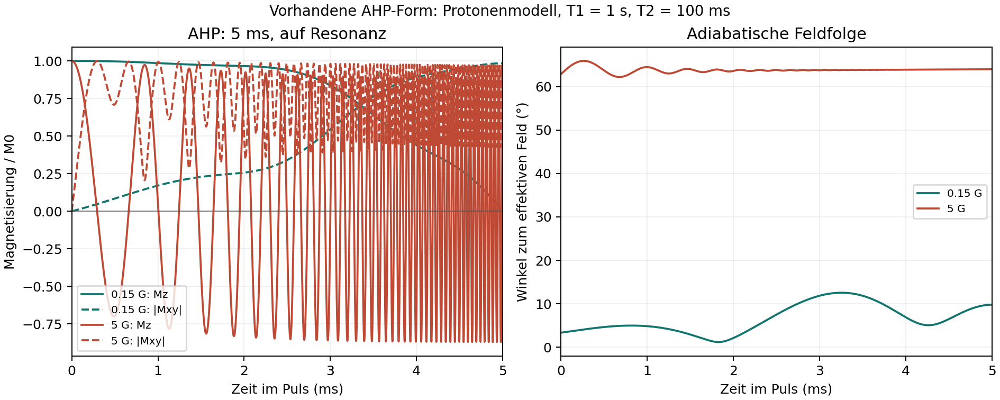

# Free Mode: AHP, UI-Reaktionszeit und RAM

Untersuchung vom 7. Oktober 2026 anhand von `bloch_project_20261007_103746.blochproj`.

## Befunde

Das Projekt verwendet einen AHP mit $5\,\mathrm{ms}$ Dauer und $5\,\mathrm{G}$ Spitzenamplitude, eine Position und elf Frequenzen zwischen $-50$ und $50\,\mathrm{Hz}$. TR beträgt $10\,\mathrm{ms}$, der zusätzliche Nachlauf $5\,\mathrm{ms}$. Der gespeicherte Zeitschritt beträgt **0,01 Mikrosekunden**, also $10\,\mathrm{ns}$.

Die Ergebnisarrays enthalten 1.500.001 Zeitpunkte. Drei Magnetisierungskomponenten mit jeweils 64 Bit und das komplexe Signal mit 128 Bit benötigen zusammen 40 Byte pro Zeitpunkt und Spin. Mit Zeitachse sind es rund **640,9 MiB reine Ergebnisdaten**. Die komprimierte Projektdatei ist rund 489 MiB groß.

Die wesentlichen Engpässe waren:

1. Der serielle Cython-Aufruf hielt den Python-GIL während des C-Rechenkerns. Der vorhandene Hintergrundthread konnte deshalb die Python-Callbacks der Oberfläche blockieren. Der parallele Aufruf gab den GIL bereits frei, wurde jedoch erst ab 256 Kombinationen aus Position und Frequenz verwendet. Elf und 31 Frequenzen liefen im seriellen Pfad.
2. Für die Animation wurde eine weitere vollständige Kopie aller drei Magnetisierungskomponenten erzeugt. Im vorliegenden Projekt waren das zusätzlich rund 378 MiB.
3. Das 3D-Vorschaudiagramm enthielt ebenfalls 1,5 Millionen Punkte. Cursorbewegungen können auch eine Neuzeichnung der dahinterliegenden Kurven auslösen. Das beeinträchtigte Pause, Reset und Scrubbing nach Abschluss der Berechnung.
4. Magnetisierungs- und Signaldiagramme bekamen große vollständige Arrays, auch bei sehr feinem Rechenraster.
5. Die pauschale AHP/AFP-Empfehlung erzwang einen globalen 10-ns-Zeitschritt auch während RF-freier Wartezeiten. Zusätzlich wurde die RF-Phase mit einer kumulierten Rechtecksumme berechnet. Damit änderte sich bereits die erzeugte Pulsform beim Ändern des Rasters.

## Warum die RAM-Warnung schnell erscheint

Der Simulator prüft eine konservative Schätzung vor der Allokation der Ergebnisarrays. Für den bisherigen zeitaufgelösten Pfad lautet sie näherungsweise:

$$
M_{\mathrm{Schätzung}} = 64 N_t N_p N_f + 64 N_t + 56 N_p N_f
$$

Dabei ist $M$ in Byte, $N_t$ die Anzahl der Rechenschritte, $N_p$ die Anzahl der Positionen und $N_f$ die Anzahl der Frequenzen. Die Schätzung berücksichtigt temporäre Arrays zusätzlich zu den eigentlichen Ergebnissen.

Bei 1,5 Millionen Schritten ergeben sich ungefähr 1,07 GiB für elf Frequenzen und 2,86 GiB für 31 Frequenzen. Das erklärt eine frühe Warnung trotz kurzer physikalischer Simulationsdauer. Ein 10-ms-Puls passt weiterhin in die vorhandenen 10 ms TR; mit 5 ms Nachlauf bleibt die Gesamtdauer hier 15 ms.

Im automatischen Modus basiert das Budget auf dem **aktuell verfügbaren** Arbeitsspeicher. Normalerweise bleibt die größere Reserve aus 2 GiB und 10 % des physischen RAM frei. Bei wenig verfügbarem Speicher gibt es eine kleinere Notfallzulassung für kleine Simulationen. Eine höhere RAM-Freigabe hätte die eigentlichen Ursachen der UI-Probleme nicht behoben.

## Umgesetzte Änderungen

- Der serielle Rechenkern gibt den GIL frei.
- Animationsdaten werden vor dem Zusammenführen auf maximal 20.000 Zeitpunkte und ein Darstellungsbudget von 64 MiB begrenzt. Die Darstellung verwendet 32 Bit; gespeicherte Simulationsergebnisse behalten 64 Bit.
- Kurven, RF-Vorschau und Zeit-Heatmaps erhalten begrenzte Darstellungsdaten. Die ursprünglichen Ergebnisarrays alter Projekte bleiben für Datenexporte erhalten.
- Sequenz- und B1-Cursor verwenden die tatsächliche Zeit statt eines Index aus einem anders aufgelösten Raster.
- **Saved time step (us)** trennt gespeicherte Ergebnisse von internen Rechenschritten. Der Standard ist $1\,\mathrm{\mu s}$. Bei fester Integration werden kleine Blöcke gerechnet, nur die angeforderten Samples gespeichert und das exakte Endergebnis separat erhalten. Abbruch wird zwischen den Blöcken geprüft.
- **Adaptive AHP/AFP integration (FID)** aktiviert für diese Pulse im FID eine fehlerkontrollierte DOP853-Integration. Amplitude, Phase, Frequenzoffset und Relaxation gehen gemeinsam in die Magnetisierungsdynamik ein. Die relative lokale Fehlertoleranz beträgt $10^{-8}$, die absolute $10^{-10}$. RF-freier Nachlauf wird analytisch propagiert. Das gespeicherte Zeitraster bleibt gleichmäßig und damit für die FFT geeignet.
- Die Phase von AHP und AFP wird analytisch integriert. Die adaptiven Pulsintervalle berücksichtigen die halben Rasterabstände um die RF-Samplezentren. Die FID-Verlängerung berücksichtigt die vollständige Pulsdauer.
- Reproduktionsnotebooks übernehmen adaptive Integration und Speicherauflösung.

Der adaptive GUI-Pfad gilt derzeit für AHP/AFP in **Free Induction Decay mit null Gradienten**. Andere Sequenzen behalten die feste Integration. Die 10-ns-Zwangsempfehlung entfällt.

## Bleibt das vorherige Ergebnis im RAM?

**Vorher: ja, während des nächsten Laufs.** Oberfläche und Simulator hielten Referenzen auf das bisherige Ergebnis, dazu kamen Animations-, Plot- und Exportdaten. Diese belegten Speicher, während das neue Budget anhand des verbleibenden System-RAM berechnet wurde. Es wurde kein separater pauschaler Betrag für den vorherigen Lauf addiert; sein tatsächlicher Speicherverbrauch war bereits im niedrigeren verfügbaren RAM enthalten.

**Jetzt:** Beim Start einer neuen Free-Mode-Simulation werden diese Ergebnisreferenzen und Darstellungsdaten vor der neuen Speicherprüfung freigegeben. Das bisherige Ergebnis ist dann auch bei einem Fehler des neuen Laufs nicht mehr in der Oberfläche verfügbar. Bereits gespeicherte Projektdateien bleiben erhalten. Eine sofortige Abnahme der angezeigten Prozessgröße ist wegen Speicherverwaltung und Betriebssystem-Caches nicht garantiert.

Die Sitzungshistorie von Sequence Mode ist davon unabhängig: Dort können frühere Läufe absichtlich im Simulation Explorer gehalten werden.

## Validierung

Vergleich mit einem festen 10-ns-Rechenraster bei derselben RF-Wellenform, $M_0=1$, $T_1=1\,\mathrm{s}$, $T_2=100\,\mathrm{ms}$, $5\,\mathrm{G}$ Spitzenamplitude und 15 ms Gesamtdauer:

| AHP-Dauer | Frequenzen | Gespeicherte Zeitpunkte | Ergebnisdaten einschließlich Zeitachse | Maximale Endzustandsabweichung |
| --- | --- | --- | --- | --- |
| 5 ms | 11 | 15.001 | 6,41 MiB | $1{,}3\times10^{-7}$ |
| 10 ms | 31 | 15.001 | 17,85 MiB | $3{,}2\times10^{-7}$ |

Die reine adaptive Integration einschließlich Signalerzeugung dauerte in diesem lokalen Vergleich ungefähr 0,16 beziehungsweise 0,26 Sekunden. Diese Zahlen enthalten nicht das Laden eines Projekts, die RF-Erzeugung oder das Zeichnen der Oberfläche und sind keine allgemeine Laufzeitgarantie.

Die RF-Abtastung bleibt eine eigene Fehlerquelle. Ein RF-Raster von $0{,}1\,\mathrm{\mu s}$ statt $0{,}01\,\mathrm{\mu s}$ änderte den Endzustand dieser beiden Fälle um maximal etwa $1{,}8\times10^{-5}$. Die lokale Solvertoleranz allein begrenzt diesen Wellenformfehler nicht.

Zusätzlich wurden konstante RF-Felder mit einer unabhängigen Matrixexponentiallösung verglichen. Regressionstests prüfen auch die exakten Samples und Endzustände der blockweisen festen Integration, Abbruch, die Rasterunabhängigkeit der RF-Phase und die Ausführbarkeit anderer Python-Threads während des seriellen nativen Kerns. Über 100 relevante Tests bestanden; Notebook-, Export-, Eingabeform-, Frequenz-, Projekt- und RAM-Tests sind eingeschlossen.

Im Qt-Test ohne native OpenGL-Darstellung ließ sich das tatsächliche Projekt laden. Die Animation enthielt danach 20.000 statt 1.500.001 Darstellungszeitpunkte. Die Pause- und Reset-Callbacks dauerten jeweils unter 0,2 ms. Eine schwache Referenz bestätigte, dass das bisherige Ergebnisarray vor dem nächsten Lauf freigegeben wurde. Der anschließende AHP mit 10 ms und 31 Frequenzen lief erfolgreich. Das ist ein Nachweis der Daten- und Callback-Pfade, keine Messung der nativen OpenGL-Bildrate.

## Empfohlene Einstellungen

Für die numerische Auflösung: adaptive AHP/AFP-Integration aktiv lassen und **Saved time step = 1 us** verwenden. **Time step = 0.1 us** reicht im untersuchten Fall für eine kleine Wellenformabweichung; **0.01 us** erlaubt einen feineren Vergleich bei weiterhin getrenntem 1-us-Speicherraster. Diese Rasterempfehlung garantiert allein keinen adiabatischen 90°-Puls. Die untenstehende Parameterprüfung untersucht deshalb zusätzlich die tatsächlich erzielte Anregung.

Für die sichtbaren schnellen Magnetisierungsbewegungen hilft eine langsamere Wiedergabe, beispielsweise **Speed = 0.1 ms/s**. Interne Rechenschritte und die auf dem Bildschirm erreichbare Bildrate sind unterschiedliche Größen. Ein feineres Rechenraster allein erzeugt keine zusätzlichen sichtbaren Animationsbilder.

## Weiterer Genauigkeitsbefund: ausgewählter Kern

Das Projekt ist auf $^{13}\mathrm{C}$ eingestellt. Der bisherige Free-Mode-Rechenkern verwendet jedoch eine fest eingebaute Protonen-Konstante, $\gamma=26753\,\mathrm{rad\,s^{-1}\,G^{-1}}$, und die Kernauswahl wurde nicht an diesen Rechenpfad übergeben. Der neue adaptive Pfad übernimmt für die Vergleichbarkeit dieselbe Konvention.

Die obigen Vergleiche validieren deshalb die numerische Integration des vorhandenen Free-Mode-Modells, **nicht die physikalisch korrekte $^{13}\mathrm{C}$-Skalierung**. Dieser separate Befund ist noch unverändert und muss bei der Interpretation des Projekts berücksichtigt werden. Kleinere Zeitschritte korrigieren ihn nicht.

Quellstellen: [nativer Rechenkern](../src/blochsimulator/bloch_core.h), [Simulator](../src/blochsimulator/simulator.py), [adaptiver RF-Pfad](../src/blochsimulator/adaptive.py), [Speicherbudget](../src/blochsimulator/memory.py), [Oberfläche](../src/blochsimulator/ui/main_window.py).

## Welche Einstellungen erzeugen einen brauchbaren AHP?

Gemessen wurde unmittelbar am exakten RF-Pulsende, ausgehend von $\mathbf{M}=(0,0,1)$, mit $T_1=1\,\mathrm{s}$, $T_2=100\,\mathrm{ms}$ und 31 Frequenzen zwischen $-50$ und $50\,\mathrm{Hz}$. Der Anregungswinkel ist

$$
\theta = \operatorname{atan2}\!\left(\sqrt{M_x^2+M_y^2},M_z\right).
$$

Der Winkel beschreibt die Richtung der Magnetisierung; zusätzlich wurde der verbleibende Transversalbetrag relativ zu $M_0$ gemessen, damit Relaxationsverluste nicht durch Normierung verschwinden. Für die B1-Prüfung wurden 41 Amplitudenskalierungen von 0,8 bis 1,2 getestet, jeweils für alle 31 Frequenzen. Die folgenden Zahlen gelten ausdrücklich für den vorhandenen **Protonen-Free-Mode-Rechenkern**, nicht für korrekt skalierte $^{13}\mathrm{C}$-Physik.

| Pulsdauer | Spitzenamplitude | Winkel bei Nennamplitude, alle Frequenzen | Winkel bei zusätzlich ±20 % B1 | Kleinster Transversalbetrag bei zusätzlich ±20 % B1 |
| --- | --- | --- | --- | --- |
| 2 ms | 0,35 G | 88,73–89,30° | 86,91–92,76° | $0{,}9916 M_0$ |
| 5 ms | 0,15 G | 87,92–90,01° | 85,75–95,35° | $0{,}9761 M_0$ |
| 10 ms | 0,15 G | 87,88–93,36° | 80,17–99,75° | $0{,}9298 M_0$ |
| 5 ms | 5 G | 30,29–37,93° | 21,66–156,75° | $0{,}3581 M_0$ |
| 10 ms | 5 G | 90,92–112,42° | 9,78–169,85° | $0{,}1607 M_0$ |

Für eine gut nachvollziehbare 90°-Anregung ist **2 ms / 0,35 G** unter diesen Bedingungen die robustere der geprüften Einstellungen. Um die vorhandene 5-ms-Dauer beizubehalten, ist **5 ms / 0,15 G** brauchbar. Eine längere Dauer allein verbessert die Robustheit hier nicht: Die fest vorgegebene Pulsform verkleinert dabei auch den Frequenz-Sweep, und während des längeren Pulses treten zusätzliche Relaxationsverluste auf. Die Tabellenintervalle sind geprüfte Bereiche, keine Zusicherung für größere Offsets, andere Relaxationszeiten oder andere RF-Formen.

Weitere GUI-Einstellungen für beide Beispiele:

- Pulse type: **Adiabatic Half Passage**; RF frequency offset: **0 Hz**; Phase: **0°**.
- Kern: **H1**; eine Position; **31 frequencies**, center **0 Hz**, range **100 Hz**.
- Sequence: **Free Induction Decay**, slice gradient **0**, TR **10 ms**, extra tail **5 ms**.
- Time step: **0.1 us**; Saved time step: **1 us**; Adaptive AHP/AFP integration: **aktiv**.
- Für die Animation: Speed etwa **0.1 ms/s**.

Die Beispiele wurden über die tatsächliche GUI berechnet und lokal als vollständige Projekte mit Ergebnissen gespeichert. Diese Projektdateien sind nicht Bestandteil des Releases. Ein erneutes Einlesen bestätigte unveränderte Ergebnisarrays. Die Beispiele sind bewusst auf H1 eingestellt. Gegen eine unabhängige feste 10-ns-Referenz betrug die maximale Winkelabweichung für die drei kleineren Amplituden weniger als $10^{-6}$ Grad. Die [Messwerte und Prüfbedingungen](ahp_parameter_validation.json) sind separat gespeichert.

### Warum 5 G bei dieser Pulsform schlecht funktionieren

Ein AHP soll die Magnetisierung dem sich drehenden effektiven Feld folgen lassen. Bei der vorhandenen Form ist der Modulationsparameter intern auf $\beta=4$ festgelegt. Die Anfangsamplitude ist deshalb nicht null, sondern ungefähr

$$
B_1(0)=\frac{B_{1,\max}}{\cosh(4)}\approx 0{,}0366 B_{1,\max}.
$$

Der Frequenz-Sweep beginnt bei einem 5-ms-Puls bei ungefähr $400\,\mathrm{Hz}$ und endet bei null. Bei $B_{1,\max}=5\,\mathrm{G}$ beträgt die anfängliche RF-Amplitude bereits $0{,}183\,\mathrm{G}$, entsprechend etwa $779\,\mathrm{Hz}$ Nutationsfrequenz im Protonenmodell. Das effektive Feld ist somit am Anfang bereits ungefähr 63° gegen die z-Achse geneigt, während die Magnetisierung entlang z startet. Sie präzediert stark um dieses Feld, statt passend ausgerichtet zu beginnen. Bei 0,15 G beträgt dieser Anfangswinkel nur etwa 3,35°.

Auch die Feldfolge wurde entlang der Trajektorie geprüft: Bei 5 ms / 5 G blieb der Winkel zwischen Magnetisierung und effektivem Feld ungefähr 63–66°. Bei 5 ms / 0,15 G blieb er unter etwa 13°. Das kleinere Feld liefert damit eine brauchbare, aber weiterhin nicht perfekte adiabatische Feldfolge. Eine deutlich bessere Robustheit über große B1- und Offsetbereiche würde eine angepasste Pulsform mit passender Startamplitude und separat wählbarem Sweep erfordern. Die angezeigte automatisch berechnete TBW ist derzeit kein Regler für diese unabhängigen Entwurfsgrößen.

Die Interpretation entspricht der Beschreibung adiabatischer Pulse als Feldfolge bei hinreichend langsamer Änderung des effektiven Feldes; siehe [Wang et al., Journal of Magnetic Resonance](https://pmc.ncbi.nlm.nih.gov/articles/PMC3304500/). Die konkreten Winkel und Amplituden oben stammen aus dieser lokalen Simulation.

## Wie entstehen die rund 18 MiB?

Die **17,85 MiB** bezeichnen die fünf Haupt-Ergebnisarrays: drei Magnetisierungskomponenten, ein komplexes Signal und die Zeitachse. Sie bezeichnen weder den gesamten Prozess-RAM noch die Größe einer komprimierten Projektdatei. Die Ergebnisdaten bleiben in 64-Bit-Gleitkommapräzision beziehungsweise 128-Bit-Komplexpräzision.

Bei einer Position, 31 Frequenzen und 15 ms Gesamtdauer ergibt sich:

| Gespeicherter Zeitschritt | Gespeicherte Zeitpunkte | Haupt-Ergebnisarrays |
| --- | --- | --- |
| 0,01 us = 10 ns | etwa 1.500.001 | etwa 1,74 GiB |
| 1 us | 15.001 | 17,85 MiB |

Bei gleicher Spinzahl entstehen also ungefähr **100-mal weniger gespeicherte Zeitpunkte**. Das ist die entscheidende Reduktion. Die ursprüngliche Datei enthält nur elf Frequenzen und benötigt deshalb insgesamt etwa 640,9 MiB Ergebnisdaten, darunter jeweils etwa 125,9 MiB für $M_x$, $M_y$ und $M_z$. Der Vergleich einer einzelnen alten Komponente mit allen neuen Ergebnissen wäre nicht unmittelbar vergleichbar.

Unabhängig davon werden Animation und Diagramme mit begrenzten Darstellungsarrays versorgt. Nur die Animation verwendet 32 Bit. RF-Wellenform, Solver-Arbeitsdaten, Qt, Diagramme und sonstige Prozessdaten benötigen weiterhin zusätzlichen RAM. Auch alte Projekte werden beim Laden nicht automatisch auf das neue Speicherraster reduziert; dafür ist ein neuer Lauf nötig.

## Wie arbeitet die adaptive Integration und wo gilt sie?

Es gibt drei getrennte Raster:

1. **RF-Eingaberaster:** Die Samples beschreiben Amplitude und Phase des eingegebenen Pulses. Zwischen ihnen wird linear interpoliert. Im adaptiven GUI-Pfad beträgt dieses Raster höchstens 0,1 us, kann aber feiner gewählt werden. Ein schlecht abgetasteter Puls kann durch genauere Integration nicht nachträglich korrigiert werden.
2. **Interne Rechenschritte:** DOP853 schätzt den lokalen Fehler der Magnetisierung und verkleinert oder vergrößert seine Schritte entsprechend. Amplitude, Phase, Frequenzoffset und Relaxation wirken gemeinsam auf diese Dynamik; die Steuerung erfolgt nicht allein nach der RF-Amplitude. Relative und absolute Toleranz betragen $10^{-8}$ und $10^{-10}$. Zusätzlich gelten eine Schrittobergrenze von 20 us, mindestens 32 Schritte pro Puls durch die Obergrenze und eine Grenze aus der RF-Phasenänderung. Diese sind Sicherheitsgrenzen für den Integrator, keine tatsächliche feste Schrittweite.
3. **Gespeichertes Ergebnisraster:** Die Lösung wird mit der hochgradigen DOP853-Interpolation auf ein gleichmäßiges Raster ausgegeben, beispielsweise 1 us. Der Integrator muss dafür nicht jeden dieser Zeitpunkte als eigenen Rechenschritt verwenden. RF-freier Nachlauf wird analytisch aus Präzession und Relaxation berechnet. Die gespeicherte gleichmäßige Zeitachse bleibt für eine FFT geeignet.

Die Fehlerkontrolle ist lokal und garantiert für sich allein keinen bestimmten globalen Gesamtfehler. Deshalb wurden zusätzlich Vergleiche mit dem nativen festen Integrator und einer unabhängigen Matrixexponentiallösung durchgeführt. Die Eigenschaften von DOP853 und die Trennung von internen Schritten und `t_eval` sind in der [SciPy-Dokumentation](https://docs.scipy.org/doc/scipy/reference/generated/scipy.integrate.solve_ivp.html) beschrieben.

Das Verfahren ist mathematisch **nicht auf adiabatische Pulse beschränkt**. Der aktuelle Hilfspfad kann einen anfänglichen zusammenhängenden RF-Puls mit null Gradienten und anschließendem RF-freiem Nachlauf verarbeiten. Die **GUI aktiviert ihn momentan gezielt nur für AHP/AFP im FID**. Spin Echo, SSFP, mehrere getrennte RF-Blöcke und Gradienten verwenden weiterhin ihre vorhandenen festen Integrationspfade. Die getrennte Speicherauflösung kann im Free Mode auch bei fester Integration Speicher sparen.
